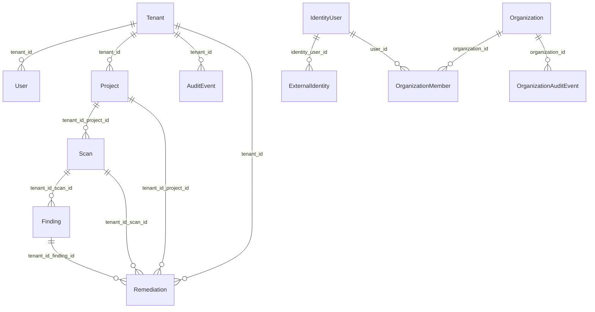

# Milestone 2C — Compatibility and Integrity Precheck

**Assessment date:** 2026-11-01

**Scope:** repository inspection only. No database connection or SQL execution was performed.

## 1. Executive assessment

**Recommendation: NO-GO for Project ownership adoption or cutover.** Proceed only with the read-only inventory and additive implementation prerequisites below. The repository establishes a single-tenant Entra identity context for current API requests, but it does not establish from code or live data that every legacy `Tenant.id` is an Entra `tid`. The legacy schema also lacks several cross-resource consistency constraints, and the Phase 06 scan worker has no per-claim fencing token. These are blockers to safely adopting Project ownership or relying on scan output during a transition.

| Classification | Finding |
|---|---|
| **Verified** | Production JWT verification uses an Entra v2 claims adapter, verifies signature and standard claims, checks a configured tenant and approved client IDs, then maps `tid` to the legacy request `tenantId`. |
| **Verified** | Current Phase 06 authorization uses signed token roles and tenant-scoped repository calls; it is not Organization-membership authorization. |
| **Verified** | Scan and remediation records retain legacy `tenantId`; no legacy resource has an Organization FK in the canonical schema. |
| **Verified** | Several schema relationships enforce tenant consistency, but Finding, Remediation, and project-associated AuditEvent do not enforce the complete Project → Scan → Finding tuple. |
| **Blocker** | Scan claims are identified by a reusable worker ID, not a fresh claim token. Some lease mutations do not check expiry; stale failure audit can be emitted after a failed conditional state update. |
| **Not verified** | Whether existing production Tenant IDs equal the configured Entra `tid`, whether stored resource tuples are consistent, and whether backup/recovery procedures have been exercised. No database was inspected. |
| **Partially verified** | Code accepts a signed `admin` role after allowlist validation, but actual Entra app-role assignment policy and deployment configuration cannot be established from the repository. |

The report does not assert that live records are corrupt. It identifies constraints that permit inconsistent rows and data checks required before strengthening them.

## 2. Legacy Tenant authorization trace

### Request path

1. `phase-08/src/main.ts`, `createProductionJwtConfig`, builds a single-tenant issuer of the form `https://login.microsoftonline.com/{OIDC_TENANT_ID}/v2.0`, configures the expected API audience, the tenant GUID, allowed client application IDs, RS256/ES256, and `EntraV2ClaimsAdapter`.
2. `phase-06/src/auth/jwt-verifier.ts`, `verifyJwtTokenAsync` / `verifyJwtToken`, validates the JWT signature using the configured key/JWKS path before accepting claims. `verifyPayloadClaims` requires exact issuer, expected audience, numeric `exp`, and valid `nbf` when present.
3. The `EntraV2ClaimsAdapter.adapt` requires `ver === "2.0"`, `idtyp === "user"`, valid `tid` equal to the configured tenant GUID, `azp` in the configured client allowlist, non-empty `sub`, and non-empty `roles` containing only `admin`, `operator`, or `viewer`. It maps `sub` to `userId`, lower-cased `tid` to `tenantId`, and roles to the request identity.
4. `phase-06/src/api/server.ts`, `authenticate` and the API request handler, rejects invalid or absent identities with 401 and assigns `const tenantId = identity.tenantId`. Phase route extensions receive this same verified identity.
5. Phase 06 route dispatch calls `hasPermission(identity, permission)` and supplies the context `tenantId` to repositories. For example, project listing calls `projectRepo.list(tenantId, ...)`, and project reads use tenant-scoped repository lookup. Scan/finding routes similarly scope repository operations by the identity tenant.
6. Phase 08 identity endpoints can resolve the SaaS `IdentityUser` using the verified principal’s issuer and subject. This does not currently replace Phase 06’s token-role authorization or legacy tenant scoping.

### Answers to the requested authorization questions

1. **Is `admin` taken from a cryptographically verified token?** Yes in the production Entra path: signature verification precedes claims adaptation, and the adapter consumes the signed `roles` claim.
2. **Is it checked against a trusted role allowlist?** Yes. Entra mode rejects a missing/empty role list and rejects any role outside `admin`, `operator`, `viewer`. The generic compatibility path in `verifyPayloadClaims` instead retains recognized roles and may ignore unknown entries when at least one known role is present; production main configures the stricter Entra adapter.
3. **Can a user obtain admin without the expected app-role assignment?** The code grants admin only when the verified token contains `admin`. Whether Entra issues that claim only after an approved app-role assignment is **not verifiable from repository code**; it depends on app registration and assignment policy. Do not treat the code check as proof of deployment-side assignment controls.
4. **Is the role Tenant-specific?** The request tenant is the configured single Entra tenant (`tid`). The role is a token app-role claim accepted in that token context; the code does not resolve a role from a Tenant-specific database membership. It does not support arbitrary legacy Tenant-specific roles.
5. **Does the implementation establish authority over the Tenant or merely trust token claims?** It validates signed issuer, audience, tenant, client, token type and role claims, then uses the resulting `tid` as tenant scope. It does not prove that a corresponding `Tenant` row exists or that a user has a database-backed membership/authority over that row.
6. **What if `tid`, issuer, subject, or roles are invalid?** The adapter rejects invalid/missing `tid`, `sub`, or roles; common validation rejects issuer/audience/expiration issues. The API receives no identity and returns 401. A token with an unexpected client, token version, or token type is likewise rejected.

**Classification:** token-validation behavior is **Verified** in source. Entra role assignment configuration and actual deployed issuer/audience/JWKS values are **Not verified**.

## 3. Tenant ID provenance and compatibility

The current Entra production adapter maps `tid` directly to `identity.tenantId`; there is no transform or lookup. Phase 06 project creation passes this identity tenant to `ProjectRepository.create`. Scans and Findings are created with tenant IDs derived from the authenticated request and associated project/scan. Phase 08 remediation API creation validates project/finding scope and stores the same legacy tenant context; remediation worker leases and loads remain tenant-scoped. Audit calls generally receive the tenant from the route or job context.

The canonical Phase 08 schema declares `Tenant.id` as a string with UUID generation default (`String @id @default(uuid())` in Prisma, represented as `TEXT` in the historical SQL). Repository searches found no runtime `tenant.create` path in Phase 06–08 application source. Tenant creation appears in integration-test fixtures, including synthetic identifiers such as `it-...-tenant-alpha`, Phase 07 test tenants, and Phase 08 legacy compatibility fixtures. Unit tests also use synthetic tenant strings. These fixtures are not evidence of production ID provenance.

| Question | Finding | Classification |
|---|---|---|
| Does authenticated `Project.tenantId` represent Entra `tid`? | New requests under the configured production Entra path use the exact normalized `tid`. | **Verified** for that request path |
| Do all existing Project rows have `tenantId = configured Entra tid`? | Requires examining deployed rows and configuration; neither was inspected. | **Not verified** |
| Are there alternate runtime tenant creators or hardcoded production tenant IDs? | No runtime Tenant creator or production hardcoded tenant ID was found in the searched Phase 06–08 source. Test-only fixture creation exists. | **Partially verified** (repository search, not exhaustive runtime/deployment evidence) |
| Can a Tenant safely be treated as an Organization? | No. Tenant is the existing authorization/resource partition; Organization is an independent SaaS entity and no mapping FK exists. | **Verified** |

Do not infer individual user ownership from resource ownership or email. Follow the approved design’s explicit migration/adoption eligibility checks and preserve every existing Tenant, User, and resource. A legacy Tenant may need a deliberate mapping to an Organization; cardinality must be decided and enforced rather than assumed. The 2B design’s same-principal and membership conditions are necessary gates, but do not establish that existing rows satisfy them.

## 4. Database integrity assessment

### Current ownership diagram

There is currently **no relation** from Project, Scan, Finding, Remediation, or legacy AuditEvent to Organization. SaaS identity and organization tables coexist with the legacy ownership graph.

### Model-by-model ownership table

| Model | Primary key / ownership | Relations and database enforcement | Organization state |
|---|---|---|---|
| `Tenant` | `id` (text) | Parent of User, Project, AuditEvent, Remediation through tenant FKs. | No Organization relation or mapping. |
| `User` | `id`; required `tenantId` | Tenant FK; unique `(tenantId,email)`. | No Organization relation. Legacy user is not the SaaS `IdentityUser`. |
| `Project` | `id`; required `tenantId` | Tenant FK; unique `(tenantId,id)` supports composite child FKs; unique `(tenantId,name)`. | No `organizationId`. |
| `Scan` | `id`; required `tenantId`, `projectId` | Composite FK `(tenantId,projectId) → Project(tenantId,id)`; unique `(tenantId,id)`. | No `organizationId`. |
| `Finding` | `id`; required `tenantId`, `projectId`, `scanId` | Composite FK `(tenantId,scanId) → Scan(tenantId,id)`. The scalar `projectId` has no Project FK and is not checked against the referenced Scan’s project. | No `organizationId`. |
| `Remediation` | `id`; required `tenantId`, `projectId`, `scanId`, `findingId` | Tenant FK and separate composite FKs to Project, Scan, and Finding by tenant. These ensure each referenced row is in the same tenant, but not that the Scan belongs to the selected Project or the Finding belongs to that exact Scan/Project. | No `organizationId`. |
| `AuditEvent` | `id`; required `tenantId`, optional `projectId`, `actorId` | Tenant FK only. Optional project and actor scalars have no FK; tenant/project consistency is not enforced. | No Organization relation. |
| `IdentityUser` | UUID `id` | Owns ExternalIdentity and OrganizationMember relations. | SaaS user; separate from legacy User. |
| `ExternalIdentity` | UUID `id`; `identityUserId` | FK to IdentityUser; unique exact `(issuer,subject)`; no email-linking relationship. | Identity mapping only. |
| `Organization` | UUID `id`; `createdByUserId` | Creator references IdentityUser; creation idempotency unique per creator/key. | Organization root. No legacy Tenant link. |
| `OrganizationMember` | Composite organization/user identity | FKs to Organization and IdentityUser; membership uniqueness and status/role fields. | Membership-based role source for SaaS organization routes. |
| `OrganizationAuditEvent` | UUID `id`; organization and actor user identifiers | Organization and actor relations are represented in schema; creation events are inserted transactionally by OrganizationService. | Separate from legacy AuditEvent; correctly avoids invented tenant IDs. |

**Verified constraints:** `phase-08/prisma/migrations/20261014000000_init/migration.sql` creates tenant FKs for users/projects/audit, composite tenant/project FK for scans, and tenant/scan FK for findings. The remediation migration first used a simple Finding FK; `20261023110000_remediation_composite_fk/migration.sql` replaces it with `(tenant_id,finding_id) → findings(tenant_id,id)`.

**Integrity gaps requiring pre-migration checks:** Finding’s project/scan tuple; Remediation’s project/scan/finding chain; project-associated AuditEvent’s project existence and tenant match; optionally AuditEvent actor integrity. The schema permits such mismatches, but whether any actual rows violate them is **Not verified**. Read-only consistency queries and counts are required before adding stronger constraints; no repair should be automatic.

## 5. Phase 06 scan-worker fencing

`ScanRepository.claimNextPendingScan` uses a PostgreSQL claim CTE with `FOR UPDATE SKIP LOCKED`, atomically sets `running`, worker ID and lease timestamps, increments attempt count, and returns the job. It does **not** create a unique claim token. `BoundedScanRunner` generates one worker ID per runner instance and reuses it for successive jobs/claims.

`renewLease` checks scan ID, tenant ID, worker ID and `running`, but not `lease_expires_at > NOW()`. An expired lease can therefore be extended before a reaper changes the row. `completeScanWithFindings` does check the expiry with database `NOW()` and updates scan plus deletes/publishes findings in one transaction, so that specific publication fails when the row is already expired or reclaimed. Its ownership discriminator is still the reusable worker ID, not a claim generation. `failScanWithLease` checks identity/status but not expiry. `reclaimExpiredLeases` requeues/fails by database time, without a per-attempt token.

The runner continues requirement inspection after lease loss; heartbeat calls are fire-and-forget and do not cancel work. Its completion transaction prevents findings publication when its predicate no longer matches, but success audit is a separate write after the transaction. In the catch path, the runner ignores whether `failScanWithLease` changed a row and writes `SCAN_FAILED` regardless. Thus an old attempt can leave a misleading failure audit after it no longer owns the scan. With the same worker ID reused, worker-ID matching alone cannot distinguish an earlier attempt from a later claim.

| Stale-worker action | Current assessment |
|---|---|
| Complete a reclaimed job | Conditional completion plus expiry blocks a plainly expired/reclaimed row; reusable worker ID leaves same-runner claim-generation ambiguity. **Blocker** pending token fencing. |
| Publish findings after losing lease | Findings are transactionally gated by completion update, so a failed predicate rolls back publication. No explicit cancellation; results are computed unnecessarily. **Verified limitation**. |
| Overwrite another attempt’s results | A stale completion whose predicate fails cannot replace findings. Fresh-token fencing is still required to prove ownership across reclaims. |
| Continue after expiry | Yes; external/read-only inspection may continue. Its DB completion should fail on expiry, but stale failure audit may still be written. |

### Required fencing changes (not implemented here)

- Add a nullable UUID `lease_token` to Scan using an additive migration; generate a fresh UUID for every claim and return it to the runner.
- Pass `(scanId, tenantId, projectId, status=running, leaseToken)` through heartbeat, completion, failure, and recovery operations. Use database time for every lease predicate; heartbeat and completion/failure must require `lease_expires_at > NOW()`.
- Make recovery conditional on the observed token plus `lease_expires_at <= NOW()` and atomically clear/replace lease ownership when requeueing.
- Keep claim, terminal status, finding replacement/publication and any success/failure audit associated with that transition in a single transaction, or append the audit only after a confirmed fenced transition. A zero-row update must produce no terminal audit.
- Stop or cancel work after heartbeat failure where possible; regardless, discard results and prohibit all writes after token loss.
- Test token A expiring, token B reclaiming (including same worker process/ID), then token A’s heartbeat, fail, completion, finding publication, and audit all being rejected.

## 6. Migration risks and prerequisites

Adding Organization ownership cannot be a `tenantId` rename. Existing FKs and all Phase 06/07/08 repository contracts depend on tenant IDs. Use additive nullable ownership/mapping fields and preserve the old graph during expansion. Before enforcing Organization tuple FKs, inventory and resolve all pre-existing mismatches through an explicitly reviewed repair plan.

Key risks:

1. **Identity mapping:** matching Entra `tid` alone does not prove a particular user owns all resources in that tenant. Email matching is prohibited. Existing project/resource ownership cannot establish individual identity.
2. **Cardinality:** decide and constrain whether one legacy Tenant can map to one or several Organizations and whether an Organization can aggregate multiple legacy Tenants. Do not backfill implicitly.
3. **Cross-row consistency:** new `(organizationId, projectId)` constraints need parent unique keys and compatible child keys. Preserve tenant constraints during transition and validate existing tuples first.
4. **Audit:** legacy AuditEvent has a tenant FK but no project FK. Keep it intact; organization audit must use its own organization identity and must not fabricate Tenant IDs. Define retention/correlation before any later unification.
5. **Worker:** scan writes are not fully fenced by a unique attempt token. Resolve before organization-scoped scan publication is relied upon for migration validation.
6. **Operational safety:** backup restoration and rollback must be proven before DDL or backfill. Production data is outside this repository inspection.

## 7. Pre-migration checklist

### Repository-verifiable items

- [ ] Confirm the canonical Phase 08 schema and migration directory remain the sole deployment entry point.
- [ ] Preserve Tenant, legacy User, every tenant FK, and existing Phase 06–09 API/worker contract during the expansion stage.
- [ ] Add an explicit legacy Tenant ↔ Organization mapping design with cardinality, eligibility, status, unique constraints, provenance, and audit behavior.
- [ ] Add nullable Organization ownership to Project first; do not infer owner by email or resource presence.
- [ ] Decide whether child `organizationId` is denormalized; if so, constrain it against Project and validate Tenant/Organization/project tuples consistently.
- [ ] Add preflight queries and tests for Finding↔Scan↔Project, Remediation↔Finding↔Scan↔Project, and AuditEvent↔Project/Tenant consistency.
- [ ] Implement and test fresh UUID scan lease-token fencing before migration cutover.
- [ ] Keep organization audit separate from legacy tenant audit until a reviewed correlation/retention design exists.
- [ ] Add rollback-safe migration tests and test all constraints against fixtures representing both adopted and unadopted legacy rows.

### External operational evidence required

- [ ] Verify configured Entra tenant, issuer, API audience, app-role definitions, assignments, and approved client IDs in the actual deployment; never infer these from local tests.
- [ ] Produce production row counts and read-only integrity-query results; identify Tenant IDs and compare them to the configured Entra `tid` without exposing user secrets.
- [ ] Obtain an approved adoption roster/source proving each Organization and authorized owner; do not derive ownership from email or existing resources.
- [ ] Verify a current database backup, point-in-time recovery availability, restore rehearsal, migration lock/maintenance plan, and rollback/forward-fix procedure.
- [ ] Confirm migration execution identity, monitoring, expected lock duration, and post-deployment validation ownership.
- [ ] Review data retention, audit retention, and customer communications for ownership changes.

No item requiring live database or deployment evidence is claimed as completed by this report.

## 8. Exact implementation prerequisites

1. Approve legacy Tenant-to-Organization cardinality and explicit adoption source/eligibility; keep bootstrap deferred until that evidence exists.
2. Run and review read-only integrity checks against all existing data before defining stricter FKs.
3. Specify additive schema: mapping table/columns, nullable Project organization ownership, unique parent keys and composite FKs; preserve Tenant fields and constraints.
4. Decide and document how existing Phase 06 Entra token-role authorization coexists with new database-backed Organization permissions; do not silently replace legacy RBAC.
5. Implement Phase 06 scan lease tokens and audit gating, with concurrency/reclaim tests.
6. Prepare migration backup/restore and staged rollout evidence before any production migration.

## 9. Recommended implementation order

1. Freeze the adoption semantics: mapping cardinality, eligible principal, owner assignment evidence, and treatment of unmatched tenants/projects.
2. Close scan-worker fencing and stale-audit behavior; add regression tests.
3. Add read-only data-integrity preflight tooling/queries and review the results operationally.
4. Add additive mapping and nullable Project organization schema/migration, preserving legacy Tenant constraints.
5. Backfill only explicitly approved mappings and project ownership; record provenance and audit in a reviewed process.
6. Validate row counts, tenant/project tuple integrity, membership/owner existence, and composite constraints before writes are routed by Organization.
7. Switch one API/resource path at a time to Organization membership authorization while retaining a compatibility path for unadopted legacy data.
8. Observe and reconcile; contract old fields only in a later separately approved milestone after all consumers and rollback windows are clear.

## 10. Go / No-Go

**NO-GO** for Organization ownership backfill, Project ownership cutover, or production migration. The missing live identity/data/backup evidence and the verified Phase 06 scan fencing gap are blockers. **GO** for implementation planning and non-destructive preflight tooling only, provided the approved 2B design remains in force and no implicit Tenant-to-Organization or user-owner mapping is introduced.

## Files and evidence inspected

The investigation covered:

- `docs/ARCHITECTURE.md`, `docs/DECISIONS.md`, and `docs/MILESTONE_2B_ORGANIZATION_OWNERSHIP_DESIGN.md`.
- `phase-06/src/auth/jwt-verifier.ts`, `phase-06/src/api/server.ts`, `phase-06/src/rbac/guard.ts`, `phase-06/src/db/project-repo.ts`, `phase-06/src/db/scan-repo.ts`, `phase-06/src/db/finding-repo.ts`, `phase-06/src/db/audit-repo.ts`, and `phase-06/src/jobs/scan-runner.ts`.
- `phase-08/src/main.ts`, `phase-08/src/identity/identity-service.ts`, `phase-08/src/organizations/organization-service.ts`, Phase 08 remediation API/repository and worker modules, and `phase-08/prisma/schema.prisma`.
- `phase-08/prisma/migrations/20261014000000_init/migration.sql`, `20261023100000_remediation/migration.sql`, `20261023110000_remediation_composite_fk/migration.sql`, plus the SaaS identity/organization migration for additive-table and FK context.
- Relevant Phase 06–08 integration test sources for tenant fixtures, scan leases, remediation and legacy compatibility.

**Commands executed:** read-only `git status --short`; targeted PowerShell `Get-Content` line extracts; `rg -n` searches across Phase 06–08 source, schema, migration, and test paths. The broad search included existing generated `dist` output for symbol discovery, but conclusions were checked against TypeScript source. No tests, database commands, SQL, migration tools, environment-file reads, or writes other than creation of this report were performed.
